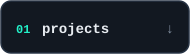
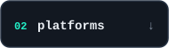
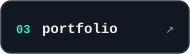
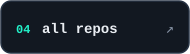

<!--
  You're reading the source. Of course you are.
  Nothing here runs JavaScript: the animations are hand-generated SVG + CSS keyframes,
  built by scripts/build.mjs (zero dependencies). Fetch the dog is 22 pixels wide
  and has never dropped a packet.
-->

<p align="center">
  <picture>
    <source media="(prefers-color-scheme: dark)" srcset="./assets/hero-dark.svg">
    <source media="(prefers-color-scheme: light)" srcset="./assets/hero-light.svg">
    
  </picture>
</p>

<p align="center">
  <a href="#things-ive-shipped"><picture><source media="(prefers-color-scheme: dark)" srcset="./assets/nav-projects-dark.svg"><source media="(prefers-color-scheme: light)" srcset="./assets/nav-projects-light.svg"></picture></a>
  <a href="#what-runs-where"><picture><source media="(prefers-color-scheme: dark)" srcset="./assets/nav-platforms-dark.svg"><source media="(prefers-color-scheme: light)" srcset="./assets/nav-platforms-light.svg"></picture></a>
  <a href="https://yashasraj.com"><picture><source media="(prefers-color-scheme: dark)" srcset="./assets/nav-portfolio-dark.svg"><source media="(prefers-color-scheme: light)" srcset="./assets/nav-portfolio-light.svg"></picture></a>
  <a href="https://github.com/yashasraj615?tab=repositories"><picture><source media="(prefers-color-scheme: dark)" srcset="./assets/nav-repos-dark.svg"><source media="(prefers-color-scheme: light)" srcset="./assets/nav-repos-light.svg"></picture></a>
</p>

## Hey, I'm Yashas.

I like the moment an idea stops being a note on my phone and becomes something you can install.

Then I like the next moment even more: when the Mac app, the Windows app, the Android app and the browser tab all start talking to each other. Most of what I build lives somewhere in that gap between devices: sending files across it, streaming media through it, linking a desktop to a phone with one QR scan.

I don't have a favourite platform. I have a favourite problem, and it's *"okay, but can it run over there too?"*

<p align="center">
  <picture>
    <source media="(prefers-color-scheme: dark)" srcset="./assets/terminal-dark.svg">
    <source media="(prefers-color-scheme: light)" srcset="./assets/terminal-light.svg">
    
  </picture>
</p>

## Things I've shipped

Click any of them open. Each one is a real thing you can run, download or read.

<details open>
<summary><b>Flashdrop</b> — send a file to another device, then let it vanish</summary>
<br>

Temporary file transfer that works in any browser. Files are encrypted on your device before they leave it, and the key rides in the link's `#fragment`, so the server never sees it. For the big stuff, **Wide Connect** skips storage entirely and streams up to 20 GB straight from one device to the other over WebRTC.

`Next.js` `TypeScript` `WebRTC` `Web Crypto` `Neon Postgres`

**[Try it](https://flashdrop-three.vercel.app)** · **[Source](https://github.com/yashasraj615/flashdrop)**

</details>

<details>
<summary><b>NeonChat</b> — one conversation, four kinds of screen</summary>
<br>

A messenger with voice and video calls that started on Android and grew outward: macOS, Windows and a browser client. Desktops don't get a password. They show a QR code, your phone scans it, and the session is linked.

`Android` `macOS` `Windows` `Web`

**[Website](https://neonchat.yashasraj.com)** · **[Installers + checksums](https://github.com/yashasraj615/Neon-Chat-Releases)**

</details>

<details>
<summary><b>LPX</b> — what is actually running on port 3000?</summary>
<br>

Local Port eXplorer. A desktop app for Windows and macOS that finds every local service and port on your machine, works out which project it belongs to, and lets you stop or restart it safely. Local-first: no account, no cloud, no telemetry.

`Windows` `macOS`

**[Website](https://lpx.yashasraj.com)** · **[Download](https://github.com/yashasraj615/LPX-release/releases/latest)**

</details>

<details>
<summary><b>Lumio Stream</b> — a private cinema you host yourself</summary>
<br>

A self-hosted media server for a small circle of people. A Mac or Windows machine runs the server in the background with a native admin app; everyone else watches and listens from a browser.

`macOS` `Windows` `Web` `self-hosted`

**[Website](https://lumiostream.yashasraj.com)** · **[Releases](https://github.com/yashasraj615/Lumio-Stream-Releases)**

</details>

<details>
<summary><b>Omni UI</b> — bring your own keys, run it on your own machine</summary>
<br>

A self-hosted AI workspace for chat, UI generation, image and video. You paste your own provider keys (encrypted at rest), and it runs on your hardware. On a Mac it ships as a tray app that manages a local server; elsewhere it runs in Docker.

`TypeScript` `React` `Docker` `self-hosted`

**[Source](https://github.com/yashasraj615/omni-ui)**

</details>

Also on the workbench: [**Nexus Stream**](https://github.com/yashasraj615/Nexus-stream), an earlier take on the home media library in TypeScript and Rust, and [**Pingpoint**](https://github.com/yashasraj615/Pingpoint), an Android messenger with calling, written in Kotlin.

## What runs where

|                  | macOS | Windows | Android | Web |
| :--------------- | :---: | :-----: | :-----: | :-: |
| **NeonChat**     |   ●   |    ●    |    ●    |  ●  |
| **Lumio Stream** |   ●   |    ●    |         |  ●  |
| **LPX**          |   ●   |    ●    |         |     |
| **Omni UI**      |   ●   |         |         |  ●  |
| **Flashdrop**    |       |         |         |  ●  |

<sub>Flashdrop only needs one column. It runs in the browser, so it already works on all of them.</sub>

<details>
<summary>What I reach for</summary>
<br>

- **Languages:** TypeScript, JavaScript, Kotlin, Dart, Python, a little Rust
- **Web:** React, Next.js, Node.js, Fastify, Three.js, GSAP
- **Android and desktop:** Jetpack Compose, Flutter, Electron
- **Data and hosting:** PostgreSQL, SQLite, Supabase, Neon, Firebase, Docker, Vercel, Cloudflare
- **Realtime:** WebRTC, and whatever else gets two devices talking

The list changes. The habit of finishing things doesn't.

</details>

<details>
<summary><code>$ lpx scan --profile yashasraj615</code></summary>

```text
PORT     SERVICE             STATE
:22      curiosity           listening
:443     shipping            open
:3000    yet another idea    starting…
:5173    side project        hot reloading
:6153    omni-ui             bound to 127.0.0.1, as it should be
:8080    sleep               connection refused

6 services found. 1 dog on patrol. sha256 of this README: left as an exercise.
```

</details>

## Say hi

CSE at Presidency University, class of 2026. The long version, with more motion and a much bigger dog, lives at **[yashasraj.com](https://yashasraj.com)**. I'm also on **[LinkedIn](https://www.linkedin.com/in/yashas-raj-8261a82a9)**.

<p align="center">
  <picture>
    <source media="(prefers-color-scheme: dark)" srcset="./assets/footer-dark.svg">
    <source media="(prefers-color-scheme: light)" srcset="./assets/footer-light.svg">
    
  </picture>
</p>
